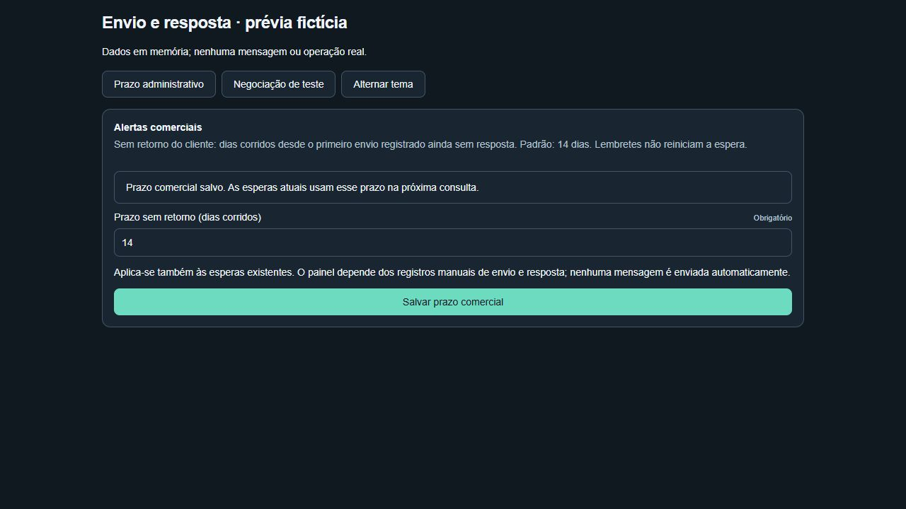
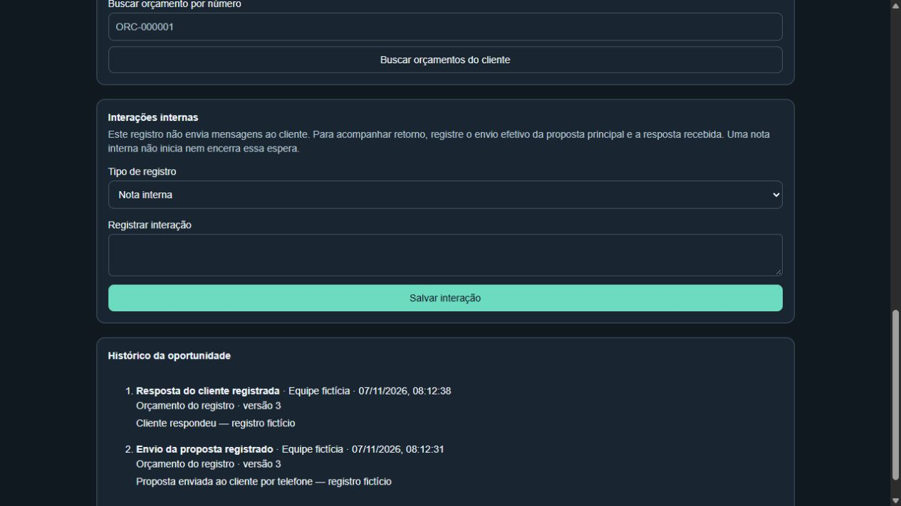

# Complemento implementado — sem retorno do cliente

07/11/2026 · PR #50 · versão mantida em **1.25.0**, sem segundo incremento.

## Regra confirmada

O usuário aprovou envio/resposta explícitos, prazo configurável pelo ADMIN com padrão 14 dias e contagem pelo primeiro envio ainda sem resposta. Lembretes não reiniciam o prazo. Em Configurações, o administrador pode informar de 1 a 365 dias corridos; a mudança vale para as esperas existentes na próxima leitura. Na ausência de preferência salva, aplica-se 14 sem criar uma linha automaticamente.

Na interação da negociação, equipe ADMIN/OPERATOR pode registrar Nota interna, Proposta enviada ao cliente ou Resposta do cliente recebida. Os dois registros novos guardam autor, instante, orçamento principal e versão. Não enviam mensagem; não interpretam notas antigas e não retrodatam contatos. Envio exige principal emitido/vigente e negociação aberta; resposta exige principal/versão atual e negociação aberta. Versão e chave de operação protegem contra repetição, edição concorrente e envio para a proposta errada.

O alerta aparece no dia civil envio + prazo, em São Paulo (envio dia 1 e prazo 14: alerta dia 15), enquanto não houver resposta registrada e a proposta principal estiver vigente com validade conhecida. Continua agrupado com atraso de contato e vencimento. Nova revisão exige novo envio; troca real de principal e reabertura invalidam ciclos anteriores. Selecionar o mesmo principal não silencia a espera. Registros encerrados, secundários, expirados/convertidos e sem validade não recebem alerta de sem retorno. Ausência de envio explícito continua sendo falta de evidência, não confirmação de contato em dia.

## Persistência e acesso

Novos tipos em OpportunityEvent, sem tabela de notificações. Apenas a preferência exige migração aditiva: `20261107110000_commercial_reply_settings`, singleton CommercialSettings com versão otimista, autor e restrições de prazo. Rota `/api/commercial-settings` é ADMIN e no-store, com proteção de origem existente; OPERATOR continua consultando o critério pelo painel, sem ganhar acesso à configuração/financeiro. Os detalhes e histórico do registro continuam no escopo atual da negociação.

## Evidências do complemento

- Redutor/validação, API, serviço e UI têm testes direcionados; RED observado antes da implementação de regra, configuração e controles.
- Migração real baseline → nova migração e reaplicação em PostgreSQL 17 **descartável e exclusivo** `127.0.0.1:55434/b2t_e4_test`; Customer e Quote sintéticos anteriores permaneceram idênticos. Ausência de backfill e constraints de singleton/prazo verificadas.
- Seis integrações novas: envio/resposta de operador, idempotência, lembretes, default14, prazo ADMIN, disputa por primeira gravação, versões/principal/encerramento, troca real e volta ao principal, reabertura; rotas com sessão ADMIN/OPERATOR/inativa e no-store. Sem servidor HTTP Next iniciado: handlers executados diretamente, com sessões somente no banco descartável.
- Revisão independente sem falhas confirmadas; casos de troca/volta e reabertura sugeridos pelo revisor incorporados à integração.
- Build de produção, tipagem e lint aprovados. Suíte unitária completa final: **928 testes em 224 arquivos aprovados**; E4 completa: **27 testes em oito arquivos aprovados**, incluindo as seis integrações novas.
- Prévia sintética em memória: configuração 14, salvar preferência, envio/resposta explícitos, histórico com link ao orçamento, alerta com data/prazo/motivo. Desktop e iframe390 px, claro/escuro e foco até Salvar. A prévia intercepta somente suas chamadas fictícias; nenhum dado real é acessado.

Limite mantido: sem ensaio HTTP autenticado por servidor Next ou homologação humana. Nenhum contorno ao bloqueio anterior de inicialização do Next. Não foram acessados banco, sessão, usuários ou contêineres operacionais; o banco dos testes é novo e descartável. Migração operacional, merge, Release de distribuição e implantação não autorizados/realizados.

Prévia: `node tests/commercial-alerts-preview-server.mjs`, páginas `/tests/reply-tracking-preview.html`, `/tests/reply-tracking-mobile.html` e `/tests/commercial-alerts-preview.html`. Migração: `E4_TEST_DATABASE_URL` exclusiva e `node --import tsx tests/e4/reply-migration-validation.ts` exige banco vazio; testes pelo `npm run test:e4`.

---

## Registro histórico anterior ao complemento

# Alertas comerciais — entrega local parcial

07/11/2026 · branch `codex/alertas-comerciais` · base main `bd0b4eb` / 1.24.0 · versão preparada 1.25.0.

## Comportamento implementado

- Na prioridade existente do Comercial e da Visão geral: contatos agendados antes do dia civil atual, propostas vigentes de hoje até sete dias à frente (janela preexistente).
- Cada negociação tem uma linha reunindo contato atrasado e vencimento do principal; responsável, próxima ação, prazo e motivo levam ao detalhe correto. Avulsos levam ao orçamento.
- Só ENVIADO/APROVADO ainda válidos, sem rascunhos/expirados/recusados/cancelados/convertidos. GANHO/PERDIDO não geram prioridades. Orçamentos secundários não substituem principal encerrado. Venda cancelada não reabre orçamento convertido.
- Datas civis com hoje em America/Sao_Paulo. Hoje não é contato atrasado. Retirar ou atualizar prazo/principal/estado recalcula a projeção; sem marcas artificiais, persistência nova, agendador, mensagem ou alteração de etapa.
- Critérios e cobertura expansíveis com links: falta de validade, próximo contato e principal em PROPOSTA/NEGOCIACAO não equivale a tudo em dia. Sem responsável, o detalhe informa ausência; não inventa titular para orçamento avulso. Ausência de registros tem texto próprio.
- ADMIN/OPERATOR mantêm a leitura global já existente das negociações. Nova seleção carrega somente dados de acompanhamento, sem financeiro. Autorização de rotas e detalhes preservada.

## Decisões comerciais pendentes

Perguntado ao usuário: confirmar/manter sete dias (ou outra janela) e escolher alternativa honesta de inatividade com prazo. **Sem retorno não implementado**: INTERACTION registra texto livre, não direção, envio comprovado ou resposta do cliente. Emissão/ENVIADO e tempo desde criação não demonstram falta de resposta. Não foi criada coleta/persistência nova sem decisão. A solicitação ampla continua parcial até essa decisão.

## Evidências

- 7 arquivos e 29 testes direcionados aprovados: projeção, consultas sintéticas ADMIN/OPERATOR, UI, filtros, autorização dos painéis, manifestos, login/admin/Atualizações.
- RED observado antes de implementar domínio; dois testes de consulta falharam nos comportamentos antigos e passaram após integração; UI falhou antes da expansão e passou após implementação.
- Fronteiras: hoje/dia sete/dia oito, vencido, estados terminais, secundários, principal convertido/ausente, duplicidade, falta de data, atualização de contato, dezembro/janeiro e meia-noite São Paulo.
- Build Next de produção aprovado (80 páginas), sem .env operacional. Tipagem e lint finais aprovados, assim como nova execução de build com a versão 1.25.0 preparada.
- Revisão independente sem achados relevantes; 19 testes focados executados pelo revisor. Sugestão de fronteiras temporais incorporada nos testes.
- Prévia Vite sintética em desktop 1280×720 e iframe de 390 px; temas claro/escuro, expansão, foco e Tab até o link Abrir. A tabela conserva a rolagem horizontal interna existente no celular; não alarga o quadro. Destinos conferidos na árvore de acessibilidade e testes, sem navegar para registros fictícios.
- Suíte unitária completa final: **915 testes em 220 arquivos aprovados**, execução estável de 221,64 s. Avisos jsdom de navegação não implementada não produziram falhas. Primeira rodada interrompida após mudança concorrente da versão causar inconsistência no teste de manifestos; não foi tratada como aprovação.

Não executados: HTTP autenticado, persistência/consulta em PostgreSQL real ou homologação humana. Nenhum servidor Next iniciado, sem contorno ao bloqueio automático anteriormente relatado. Não foi acessado banco operacional, criada sessão/usuário artificial, migrado banco, copiado .env, enviado mensagem, modificado outro chat ou contêiner.

## Arquivos e reprodução

Domínio `src/domain/dashboard/commercial-alerts.ts`; consulta `src/server/dashboard/commercial.ts`; repasse da cobertura na visão geral/painel; componente `priority-table.tsx`. Testes novos em `tests/unit/commercial-alerts.test.ts` e ampliações dos testes existentes. Sem dependências ou schema novos.

Prévia: `node tests/commercial-alerts-preview-server.mjs`; abrir `http://127.0.0.1:4186/tests/commercial-alerts-preview.html` ou `http://127.0.0.1:4186/tests/commercial-alerts-mobile.html`. Somente fixtures, sem autenticação e sem dados reais.

## Estado da entrega

Worktree separada; pasta operacional X:/codex/appb2t e seus documentos/skills locais preservados. PENDENCIAS/roadmap atualizados somente nesta branch, mantendo histórico. 1.25.0 MINOR preparada uma única vez, manifestos sincronizados, APP_VERSION derivado do manifesto e notas em português; comparar novamente com main antes de futura PR. Sem commit/push/PR/merge/Release/publicação ou implantação operacional. Acesso efetivo usado sem alegar alteração da permissão do chat.

## Preparação da PR autorizada — 07/11/2026

Usuário solicitou “faca pr”. Main reconferida bd0b4eb/1.24.0; versão 1.25.0 já preparada foi mantida, sem segundo incremento. Revalidação de 23 testes em quatro arquivos aprovada (domínio, consulta, UI e versão/rodapés/Atualizações). Commit/push/PR autorizados; abertura em rascunho para revisão do recorte entregue, sem presumir aprovação do critério comercial pendente. Estados anteriores descrevem a entrega local antes dessa autorização. Sem merge, Release de distribuição ou implantação operacional.

[PR #50](https://github.com/bsgirardi/appb2t/pull/50) criada em rascunho, implementação `eaa8b3f`, versão 1.25.0. CI iniciado, resultado ainda pendente; sem merge/Release/deploy.
