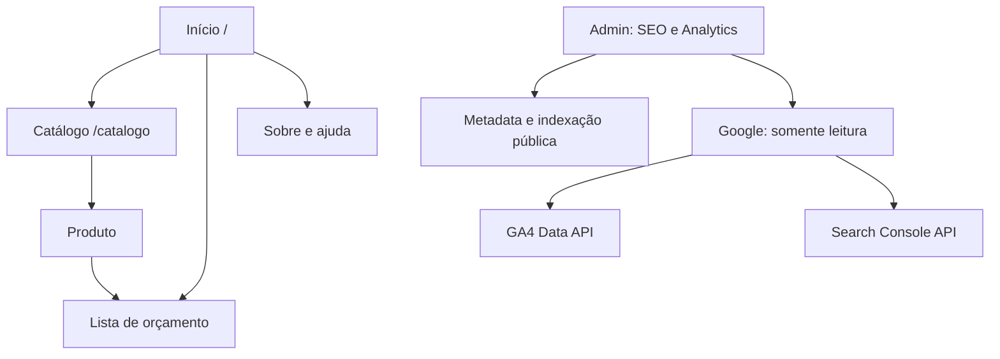

# Início institucional, catálogo e Google

Implementação local proposta na versão 1.28.0. Fonte inicial: main 8817d5b / 1.27.14. Não integrada ou publicada.

## Páginas e fontes de conteúdo

| Página | Endereço | Conteúdo e fonte |
| --- | --- | --- |
| Início | `/` | Marca oficial, abertura existente, processo baseado no fluxo atual, destaques e texto Sobre de Aparência |
| Catálogo | `/catalogo` | Busca, categorias, filtros, produtos reais cadastrados e kits; sem banner grande |
| Produto | `/portfolio/produto/:id/:slug` | Produto ativo, imagens e SEO existentes; opções e regras comerciais preservadas |
| Sobre / ajuda | `/portfolio/sobre`, `/portfolio/ajuda` | Texto e perguntas cadastrados; só existem com conteúdo |
| Orçamento / compra / checkout / arte | caminhos existentes em `/portfolio` | Continuam fora de indexação e da coleta de páginas |
| SEO e Analytics | `/configuracoes/seo-analytics` | Somente ADMIN; OPERATOR não tem menu nem acesso às APIs |

Cabeçalho e rodapé levam ao catálogo, orçamento e páginas informativas. O logo volta ao início. O breadcrumb de produto volta ao catálogo com filtros. `/portfolio` faz 308 para `/catalogo`; consultas antigas de catálogo em `/` fazem 308 preservando todos os valores, inclusive repetidos e UTMs. Raiz com apenas UTMs permanece institucional. A âncora antiga `/#all-products` continua oferecendo acesso ao catálogo. Não há redirecionamento de `/catalogo` para `/`.

Configurações prévias de abertura, banners, coleções em destaque e ordem de seções foram mantidas no início; o item antigo “Todos os produtos” agora abre coleções e catálogo completo. Produtos não foram movidos de URL. Capa/descrição de coleção e disponibilidade vêm dos dados existentes.

## Material e afirmações

Logo e mascote oficiais locais são os únicos ativos editoriais fixos. O mascote é ilustração de marca; não é case, produto ofertado, depoimento ou prova comercial. Não se adicionaram avaliações, clientes, promoções, prazos ou políticas. Textos já cadastrados continuam sob responsabilidade editorial da equipe.

A descoberta no Drive conectado encontrou `_B2T-STUDIO`, as pastas `site` (sem itens retornados), `MKT` e `Dia dos professores` (sem itens retornados). Nenhum arquivo foi baixado, publicado ou usado por inferência. Perfil Instagram e autorização de posts/fotos ainda não foram informados neste chat. A seção de trabalhos reais e bastidores precisa dessas fontes; não foi preenchida com imagens fictícias. Identificador de domínio `somosb2t.com.br` aparece em `.env.example`, mas não prova o domínio efetivamente configurado na produção.

## Persistência e SEO

Sem alteração de schema e sem nova migração. `CompanyAppearance.storefront` recebe os objetos opcionais `seo` e `analytics`. Catálogo continua usando `seoTitle` e `seoDescription` já existentes; produtos usam seus campos existentes. Coleções herdam nome, descrição e capa. Não há cópia de dados de produto/coleção em um CMS novo.

Salvamento dedicado altera somente SEO/identificadores e títulos do catálogo. Compartilha o lock `b2t:appearance` e a versão otimista de Aparência, rejeitando conflitos com 409. Clientes antigos que omitem novos objetos ao salvar Aparência preservam os valores existentes. Identidade, paletas, logo e merchandising não são substituídos pelo endpoint novo. Os identificadores Google não são segredos; credenciais nunca entram no JSON público.

APP_URL é a única fonte do domínio canônico e deve conter a origem HTTPS pública. Defaults funcionam sem preenchimento: título/conteúdo da página, marca e imagem oficial. Overrides são restritos a início, catálogo, sobre e ajuda. Fotos específicas de produto/coleção prevalecem sobre a imagem padrão. O seletor oferece marca e até 100 produtos/100 coleções ativos com imagens; não aceita URL externa de rastreamento.

Desativar indexação pública aplica noindex às páginas públicas e as remove do sitemap. Não ativa privado em hipótese alguma. Busca, ordenação e filtros comerciais continuam noindex,follow. Canonical conserva coleção/paginação, removendo critérios de busca/preço/ordem. Login/admin mantêm noindex padrão e as proteções anteriores; robots inclui namespaces privados e permite imagens públicas. Robots/noindex não substituem autenticação.

JSON-LD do início contém somente Organization/WebSite, nome, URL e logo reais configurados. Produto mantém Product/Offer e BreadcrumbList existentes, com catálogo atualizado. Sem avaliações ou resultados comerciais inventados.

Redirecionamentos editáveis são 308 para caminhos antigos não ocupados, atendidos pela rota catch-all. Destino precisa ser uma página pública conhecida ou produto/conjunto, sem query/hash; consultas de entrada são preservadas. Prefixos do sistema, origem externa, fontes repetidas, ciclos e cadeias são rejeitados. Existência/publicação do produto de destino precisa ser conferida pelo editor; não se publicam produtos por redirecionamento. Remover uma regra faz o caminho antigo voltar a 404.

## Configuração Google após autorização

Nada abaixo foi feito em conta ou produção. O responsável deve autorizar conta/projeto/propriedades antes de executar:

1. Usar projeto Google autorizado, configurar cliente OAuth Web e disponibilizar Analytics Data API e Search Console API conforme as permissões da organização. Não criar projeto ou aceitar termos automaticamente.
2. Cadastrar exatamente `APP_URL/api/marketing/google/callback` como redirect do cliente Web. Revisar o consentimento/estado de teste e usuários autorizados no Google.
3. Guardar `GOOGLE_OAUTH_CLIENT_ID`, `GOOGLE_OAUTH_CLIENT_SECRET` e uma chave exclusiva de 32 bytes hex em `GOOGLE_TOKEN_ENCRYPTION_KEY` no ambiente protegido do servidor. Não compartilhar segredos pelo chat nem reutilizar ART_ACCESS_KEY/CHECKOUT_ACCESS_KEY. Compose encaminha essas variáveis, vazias por padrão.
4. Em SEO e Analytics, informar tag `G-...`, número GA4 e propriedade Search Console (`sc-domain:...` ou origem HTTPS com barra final), e salvar. A conta selecionada deve ter leitura nas propriedades.
5. Clicar Conectar conta Google e autorizar conscientemente os escopos `analytics.readonly` e `webmasters.readonly`. Sem Cloud Platform, Admin, escrita ou acesso a contatos/e-mail. A conexão não identifica o nome/e-mail da conta: a escolha ocorre na tela Google, e o painel identifica as propriedades consultadas.

OAuth usa state aleatório, PKCE S256, expiração e vínculo ao administrador autenticado. Tokens ficam em cookie HttpOnly AES-256-GCM com chave dedicada, SameSite=Lax, Secure em HTTPS, caminho restrito às APIs Google e validade de até 30 dias. Acesso expira e é renovado no servidor quando há refresh token. Conexão é individual por navegador; não é uma integração compartilhada por todos os administradores. Trocar chave/logout de usuário impede uso por outro ator, mas revogação completa é feita na conta Google. Desconectar no painel apaga os cookies locais de autorização. Nunca são retornados tokens/segredos ao JavaScript da página ou aos relatórios.

Falhas de OAuth retornam estado genérico, sem exibir payloads Google. APIs locais exigem ADMIN; mutações verificam Origin e JSON com limite de tamanho. Callback não registra code/token e retorna para destino fixo. O ambiente Google real, expiração/revogação e configuração OAuth ainda precisam de homologação autorizada.

## Relatórios e definições

GA4 usa Data API v1beta: activeUsers, sessions e screenPageViews no resumo comparativo; pagePath/visualizações, sessionSourceMedium/sessões, deviceCategory/sessões e eventName/eventCount nos detalhamentos atuais. Detalhamentos usam apenas o período atual, evitando que o anterior consuma seu limite de 20 linhas. Usuários não são somados entre dimensões. Eventos filtrados: contact_click, catalog_open, generate_lead, purchase. Clique, envio e compra são ações diferentes.

Períodos: 7/28/90 dias completos, até ontem, comparados com a mesma duração anterior. GA4 usa datas relativas no fuso devolvido pela propriedade. Search Console usa datas explícitas no fuso America/Los_Angeles, pesquisa web, dados finais e agregação sem dimensões para cliques, impressões, CTR e posição média. CTR é apresentado em porcentagem. Dias sem linhas são “Sem dados”, não zero. Cada fonte falha independentemente.

Fetch servidor tem timeout de 10–12 segundos. Cache por digest de credencial/propriedade/período, até 60 entradas/processo e cinco minutos, com deduplicação de chamadas em andamento; não é cache distribuído entre réplicas. O botão respeita esse cache, não força consulta ao Google. Cotas do Google ainda se aplicam. 401/403 pedem revisar acesso/reconectar; 429 pede aguardar; falha não produz números. A interface informa consulta e possível idade do cache. Não promete igualdade com todas as telas Google: períodos, filtros, thresholding, retenção, agregação e latência interferem.

## Coleta e privacidade

Desligada por padrão. Para habilitar depois de autorização editorial e de privacidade:

- Configurar tag válida e confirmar que não existe outra tag/contêiner instalado.
- Desligar pageviews e demais eventos automáticos da medição otimizada no fluxo GA4. A propriedade deve permitir somente o envio manual aqui previsto. Sem isso, a biblioteca pode coletar navegação/URLs fora deste contrato.
- Somente então definir os dois gates `GOOGLE_ANALYTICS_COLLECTION_ENABLED=true` e `GOOGLE_ANALYTICS_MANUAL_MEASUREMENT_CONFIRMED=true` no ambiente autorizado. Não se altera propriedade Google por API neste código.
- Cada visitante pode aceitar ou continuar sem medição. Não há script/requisição Google antes da aceitação. DNT=1 bloqueia a coleta. Preferência pode ser alterada no rodapé; desativar bloqueia a tag e recarrega a página. Não há garantia de exclusão retroativa dos dados coletados ou dos cookies já emitidos pelo Google.

Sem integração com CMP externa; esta é uma preferência explícita mínima para medição opcional, não um parecer legal. Política de privacidade, retenção e necessidades legais da operação precisam ser revisadas pelo responsável antes de ativar a coleta.

| Evento | Gatilho implementado | Significado |
| --- | --- | --- |
| page_view | Navegação em início, catálogo, sobre, ajuda ou produto, após consentimento | Uma visualização manual; envio automático desligado |
| catalog_open | Clique em link para catálogo | Intenção de explorar, não lead |
| contact_click | Clique em e-mail/WhatsApp público | Intenção de contato, não solicitação enviada |
| generate_lead | Leitura no painel preparada; emissão não implementada | Somente uma solicitação confirmada pelo servidor pode alimentar este evento |
| purchase | Leitura no painel preparada; emissão não implementada | Somente confirmação autoritativa de compra pode alimentar este evento |

Não se instrumentou confirmação de compra nem envio de orçamento por inferência. Retry/revisita não podem gerar conversões duplicadas; uma futura emissão autoritativa exige contrato próprio de deduplicação e consentimento, sem identificar cliente. Cliques desta entrega nunca produzem generate_lead/purchase. Caso a propriedade já receba esses eventos de outra fonte, o painel lê os eventos reais existentes.

URLs enviadas removem hash e campos livres de busca/filtros/contato. Produtos usam template `/portfolio/produto/item`, sem nome/ID no caminho enviado. Referrer fica vazio; não se enviam nome, e-mail, telefone, user_id ou tokens. UTM tem vocabulário fechado: source instagram/google/facebook; medium social/organic/cpc/referral; campaign institucional/catalogo/personalizados; content bio/stories/reels/post. Valores fora da lista são descartados para evitar PII em parâmetros livres. Exemplo para Instagram: `/?utm_source=instagram&utm_medium=social&utm_campaign=institucional&utm_content=bio`. Links internos não reatribuem UTMs; a sessão GA4 mantém atribuição quando consentida.

## Fontes técnicas consultadas

- [Skills Google Analytics](https://developers.google.com/analytics/devguides/agent-skills)
- [OAuth Web Server](https://developers.google.com/identity/protocols/oauth2/web-server)
- [Data API batchRunReports](https://developers.google.com/analytics/devguides/reporting/data/v1/rest/v1beta/properties/batchRunReports)
- [Search Analytics query](https://developers.google.com/webmaster-tools/v1/searchanalytics/query)
- [Pageviews manuais GA4](https://developers.google.com/analytics/devguides/collection/ga4/views)
- Guias locais Next 16.4.2: page, route, generate-metadata e redirects em node_modules/next/dist/docs.
