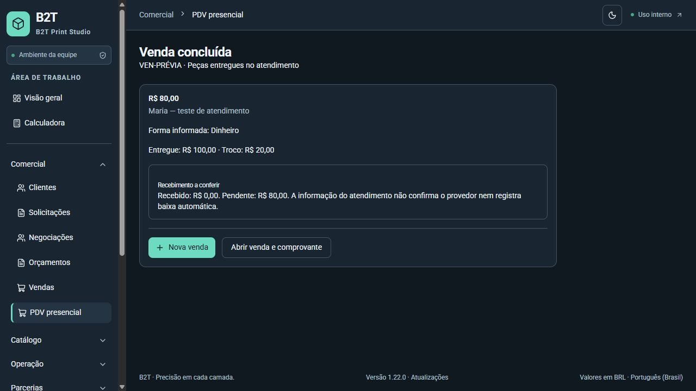

# PDV presencial — entrega local

06/11/2026. Branch `codex/pdv-presencial`, base main `16a6466b4020d1008025506387634026e29d7baa`, versão **1.22.0** preservada. Área isolada gerenciada: `C:/Users/Administrador/.codex/worktrees/pdv-presencial/appb2t`. Código e documentos preparados sem commit, push ou PR. Sem merge, Release, publicação ou migração operacional.

## O que está implementado

- `/pdv` no menu Comercial para ADMIN e OPERATOR, com os componentes instalados e a skill `.agents/skills/shadcn/SKILL.md` do projeto.
- Busca por nome/código, peças prontas livres, quantidade e faixas de preço pelo motor existente; desconto global em reais sem alterar preço cadastral.
- Comprador opcional: sem identificação explícita, cliente cadastrado ativo ou cadastro real de pessoa durante a conclusão. Sem consumidor fictício na tabela de clientes; cadastro novo exige nome e permite telefone/e-mail opcionais. Benefícios futuros não implementados.
- Uma forma informada por venda: Pix, dinheiro ou cartão; dinheiro calcula valor entregue e troco com Decimal. Não coleta números de cartão nem dados bancários.
- Revisão explícita antes de concluir. Venda, parcela/recebível, compromissos por origem e entrega imediata na mesma transação. Comandos antigos de produção e PDV chamam as mesmas funções transacionais, preservando reservas e restrições de origem.
- Rascunho no servidor com versão, botão para salvar e proteção de saída quando ainda não salvo. Falha na resposta exige consultar o mesmo pedido; repetição da conclusão recupera a mesma venda e não duplica cliente, recebível ou estoque. Outra edição salva exige escolher qual manter antes de continuar.
- Preços/revisões alterados exigem atualizar explicitamente os itens e revisar novamente. Cliente alterado ou inativo exige nova consulta/seleção.
- Pagamento declarado aparece no detalhe da venda. Nenhuma baixa automática, movimentação de caixa ou confirmação de provedor é criada; financeiro e estornos continuam sob permissões atuais. Conclusão distingue peças entregues de recebimento pendente.
- Migração de Sale.customerId nullable e PosOrder, com unicidade da venda e de rascunho aberto por operador, identificação anônima explícita validada e restrição SQL. Documentos comerciais comuns continuam exigindo cliente. Anônimos não contam como um cliente recorrente; ranking identifica o agrupamento descritivo.

## Recorte e limites

Operação exige conexão. O rascunho precisa ser salvo para retomada posterior; edições não salvas recebem aviso ao sair. Sem persistir dados pessoais em armazenamento local.

Primeira entrega atende produtos simples, ativos, disponíveis, com preço definido e estoque pronto livre inventariado. Kits, escolhas de cor/tamanho, personalizações, preço sob consulta e encomendas permanecem no fluxo comercial existente, sem cálculos simplificados no PDV. A consulta retorna até 80 produtos por busca; atualização do carrinho busca seus IDs explicitamente.

Sem pagamentos mistos, abertura/fechamento de caixa, sangria, cadastro de evento/local, adquirentes, emissão fiscal, regras tributárias ou E2.4. Cancelamento/estorno rápido não foi adicionado: entrega efetiva exige correção física pelos módulos existentes, e recebimento deve ser estornado antes de cancelamento comercial. A declaração do atendimento não provoca esses efeitos automaticamente.

## Evidências

| Verificação | Resultado |
| --- | --- |
| Suíte unitária geral | 889 testes em 215 arquivos aprovados, 264,78 s |
| Integrações específicas PDV | 9 testes aprovados em PostgreSQL exclusivo |
| Regressões comerciais/produtivas/financeiras | 15 testes em 6 arquivos aprovados no mesmo banco exclusivo |
| Focados finais de UI/contrato/recorrência | 11 testes em 3 arquivos aprovados após proteção adicional da recuperação |
| Tipagem e lint finais | Aprovados |
| Build final webpack | Aprovado; 80 páginas; repetido após último ajuste da UI |
| Migração real | SQL aplicado sobre contrato anterior NOT NULL; venda, cliente e item sintéticos preservados; anonimato sem marcador rejeitado |
| Revisão independente | Dois P2 corrigidos com RED→GREEN e rechecados; nenhum novo bloqueador concreto na rechecagem |
| Revisão visual | Desktop 1366 px e celular 375 px, claro/escuro, toque, Tab e foco após conclusão |

Integrações cobrem comprador anônimo/existente/novo, alteração de cliente, quantidades/faixas/desconto/troco, rollback de falta de peças após criação comercial, resposta perdida, dois envios simultâneos do mesmo pedido, dois operadores disputando a última peça, peças reservadas para outra venda, bloqueio de configuração, revisão comercial alterada, versão obsoleta e acesso de outro ator. Recebível único e ausência de baixa/movimento automático conferidos.

Os testes funcionais usam exclusivamente `127.0.0.1:55441/b2t_pdv_test`, com guard que rejeita outros bancos. Contêiner próprio `b2t-pdv-test-20261106`, PostgreSQL 17, removido com seu volume descartável após validação. Nenhum banco, usuário, sessão ou venda operacional foi alterado.

A prévia visual usa componentes reais com adaptador de API sintético, sem backend operacional nem bypass de autenticação. Cenário: cinco chaveiros a R$ 10,00 pela faixa e um suporte a R$ 35,00; desconto R$ 5,00, total R$ 80,00; entregue R$ 100,00, troco R$ 20,00. Tab levou da quantidade ao botão Aumentar; conclusão levou o foco ao título. Celular: largura 375 px e scrollWidth 360 px, sem transbordamento horizontal observado.

O build conserva o aviso anterior de importação nomeada da versão em `src/lib/version.ts`. A suíte unitária apresenta avisos esperados de navegação do jsdom e do teste de erro HTTP sanitizado; não houve falha.

Ensaio HTTP autenticado integral adicional preparado em `tests/pos/http-validation.ts`, mas **não executado**. A revisão automática de aprovação bloqueou iniciar o servidor Next isolado; informou apenas “blocked by policy”. Não houve contorno nem alteração de permissões. Consequentemente, esta entrega não afirma validação HTTP autenticada ponta a ponta nem homologação operacional. Autorização entre atores e financeiro foi exercitada em serviços e regressões; a UI foi conferida em prévia sintética.

Logs locais completos em `test-results/pdv/` (ignorados pelo Git). Nenhuma credencial operacional foi copiada; as credenciais do banco de teste são sintéticas e já descartadas.

## Telas

[Compra desktop clara](desktop-claro.png) · [desktop escura](desktop-escuro.png) · [compra no celular](celular-claro.png) · [conclusão no celular](celular-conclusao.png) · [conclusão escura](celular-escuro.png).

## Continuidade

O pedido autorizou desenho e implementação, não integração ou publicação. Versão local base permanece 1.22.0, sem simular versão publicada. Antes de futura PR, reconsultar main e reconciliar com PRs #46/#47, fazer incremento MINOR único, sincronizar package.json/lock, notas portuguesas e rodapés/Atualizações conforme AGENTS.md. Não reutilizar 1.23.0 sem verificar a integração da calculadora. Nenhuma tag foi criada.

Não copiar esta árvore sobre `X:/codex/appb2t`: a pasta operacional antiga e seus documentos/skills/alterações de outros chats permaneceram intactos. Revisão e eventual integração devem partir desta branch isolada, preservando os acompanhamentos paralelos.

Desenho: [contratos e recorte](../superpowers/specs/2026-11-06-pdv-presencial-design.md). Plano: [tarefas](../superpowers/plans/2026-11-06-pdv-presencial.md).

## Preparação de PR — 06/11/2026

Usuário autorizou commit/push/criação de PR com “faça pr”. Main reconferida em 16a6466 / 1.22.0. Versão 1.23.0 MINOR preparada em package.json e nas duas entradas raiz do lock; nova entrada em português no início de releases.ts, preservando notas anteriores. PR em rascunho devido ao ensaio HTTP autenticado integral pendente. Calculadora #47 ainda aberta também propõe 1.23.0; não confundir PR com integração nem reservar versão como se já estivesse em main. Reconciliar versão/notas e alterações compartilhadas de navegação com #46/#47 antes de merge. As informações anteriores descrevem a entrega local anterior ao pedido de PR. Sem autorização de merge, Release ou implantação. Revalidações e URL registradas após conclusão.

Revalidação da preparação da PR: 890 testes gerais em 215 arquivos (256,60 s), quatro testes específicos de versão/rodapés/Atualizações, tipagem, lint e build webpack aprovados em 1.23.0. Tipagem passou após o build, eliminando a disputa inicial por tipos gerados em .next; nenhum código de produto foi alterado por esse motivo. Capturas permanecem como evidência da implementação anterior ao incremento, e a versão atual nos rodapés foi conferida pelos testes. git diff --check aprovado. Main continua 16a6466 / 1.22.0.
