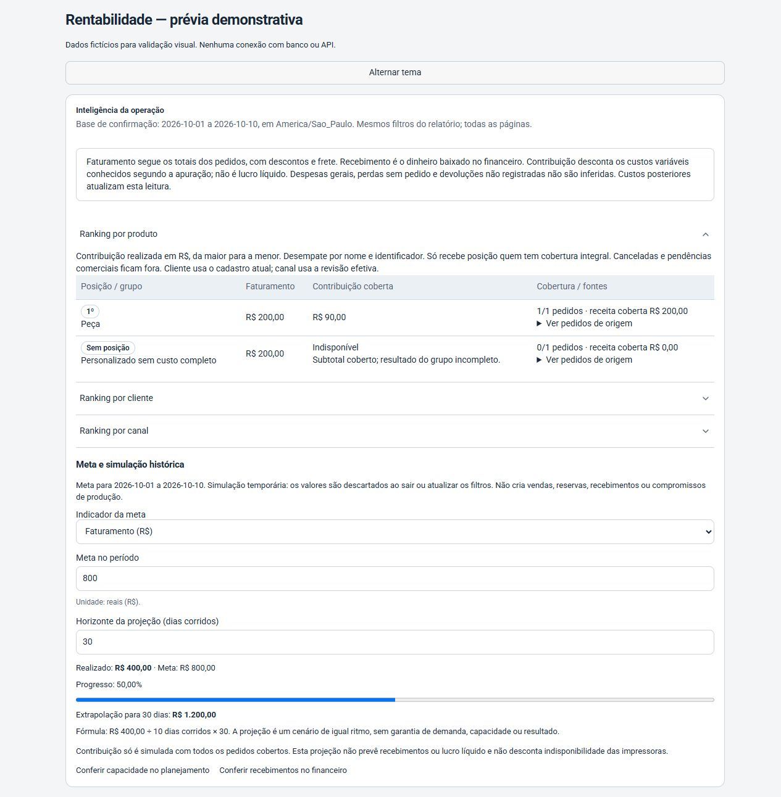
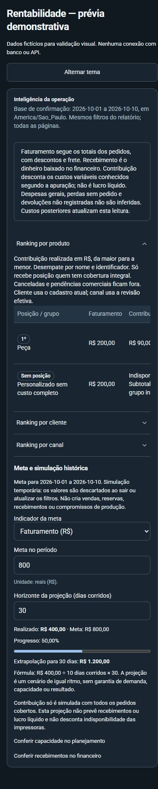

# Etapa 4 — inteligência operacional

04/11/2026 · branch `codex/admin-inteligencia-etapa4` · versão 1.16.0.

## Resultado

Em `/rentabilidade`, administradores encontram rankings por produto, cliente e canal, usando a contribuição realizada do motor existente. A população é a mesma dos filtros, antes da paginação. Cada grupo mostra receita coberta, número de pedidos cobertos e links aos pedidos de origem; custos incompletos mantêm o grupo sem posição. Canceladas e pendências comerciais seguem a exclusão existente. Clientes usam o nome atual do cadastro; canais usam a revisão administrativa efetiva. O filtro de produto continua selecionando pedidos inteiros, como explica a página existente.

Metas temporárias em reais para faturamento/contribuição ou unidades para pedidos, com período, realizado e progresso. Metas não são salvas e não geram operações. A extrapolação usa o realizado dividido pelos dias civis inclusivos do histórico, multiplicado pelo horizonte informado. Fim futuro/horizonte inválido bloqueiam somente a extrapolação. Contribuição sem cobertura integral permanece indisponível. Zero comprovado e valores negativos permanecem válidos. Sem pedidos não é apresentado como faturamento zero.

Origem temporal: primeira confirmação/conversão em America/Sao_Paulo, com custos atuais, incluindo revisões posteriores. O filtro sem data é identificado e não permite simulação. Faturamento, recebimento, contribuição e lucro líquido têm distinções explícitas. Projeção não mede disponibilidade por impressora nem demanda; há acesso ao planejamento e ao financeiro existentes. Devoluções não registradas e despesas gerais não são inferidas. Perdas não atribuídas a pedidos continuam no quadro próprio da página, fora da contribuição comercial.

## Arquivos

- Domínio: `src/domain/profitability/intelligence.ts`.
- Consulta: `src/server/profitability/queries.ts` — enriquecimento com clientes na mesma transação, sem alterar fontes, revisões ou hashes históricos.
- Interface: `src/components/profitability/intelligence-panel.tsx`, `src/app/(private)/rentabilidade/page.tsx` e regra Roboto restrita ao novo painel em `src/app/admin.css`.
- Versão/histórico: `package.json`, `package-lock.json`, `src/lib/releases.ts`. `APP_VERSION` continua derivado do manifesto.
- Testes: `tests/unit/intelligence*.test.*` e `tests/integration/profitability-queries.test.ts`; prévia reproduzível em `tests/intelligence-preview*`.
- Desenho e plano em `docs/superpowers/specs/2026-11-04-admin-inteligencia-design.md` e `docs/superpowers/plans/2026-11-04-admin-inteligencia.md`.

## Validação

- Suíte unitária completa: 188 arquivos, 763 testes aprovados. Após os ajustes finais da revisão: 7 arquivos, 26 testes direcionados aprovados, incluindo rentabilidade e versão.
- Revalidação antes da PR: 188 arquivos, 764 testes unitários aprovados, além dos sete testes de integração. Tipos, lint e build novamente aprovados.
- Cobertura: ranking, ausência de dados, custos incompletos, zero/negativos, datas civis/bissexto, virada de dia em São Paulo, fontes e paginação, ADMIN/OPERATOR, meta mensal com fim futuro, horizonte inválido e interação.
- Tipos, lint e build de produção aprovados; nenhuma migração ou biblioteca nova.
- Revisão independente encontrou duas ambiguidades corrigidas e cobertas por regressões: legenda de pedidos sem data e acoplamento indevido entre meta e validação da projeção.
- Prévia com dados fictícios em desktop (1280×900) e celular (390×844), temas claro/escuro, teclado nos controles e tabela com rolagem interna. Fonte Roboto confirmada no painel e nos gatilhos. Sem alargamento horizontal da página; campos e links visíveis.
- Login, rodapé administrativo e `/atualizacoes` testados com a versão do manifesto e para ADMIN/OPERATOR. Rentabilidade preserva sua autorização ADMIN, incluindo revalidação de usuário ativo no servidor.

Antes da PR, sete testes de integração passaram em quatro arquivos de rentabilidade (consultas, API, fontes e fluxo), usando exclusivamente PostgreSQL descartável em `127.0.0.1:55432/b2t_test`. As consultas agora verificam rankings idênticos entre páginas, vínculo real ao cadastro do cliente, pedidos de origem na virada de dia em São Paulo e ausência de rankings para canceladas. Os testes da API verificam sessão com identidade atual, acesso anônimo, ADMIN/OPERATOR e ausência de cache compartilhado. As migrações existentes foram aplicadas somente nesse banco de testes.

Sessão autenticada pelo navegador não foi testada: a revisão automática de aprovação bloqueou a inicialização do servidor local sem apresentar motivo adicional. A prévia visual usa dados fictícios. Nenhum banco de produção foi acessado.

## Integração e publicação

Base consultada: `origin/main` em 1.15.0, d1d7ac0. Etapas 1 (355e2a6 / 1.15.1), 2 (38dd157 / 1.16.0) e 3 (49e7553 / 1.16.0) estão em branches próprias, conforme os chats lidos. Seus commits não foram incorporados. A etapa 3 ainda registra margem consolidada da negociação pendente.

Esta branch incrementa MINOR uma vez em relação à main. Na preparação da PR, a main remota continuava em 1.15.0 e não havia PR aberta; nenhum novo incremento foi necessário. As etapas paralelas precisarão atualizar suas versões quando forem integradas, preservando todas as notas.

O usuário autorizou abrir a PR e fazer merge após conferir pendências. Publicação em produção permanece fora do escopo. O resultado da integração e o endereço da PR são registrados no chat e no histórico Git.

Prévia: executar `node tests/intelligence-preview-server.mjs` e abrir `http://127.0.0.1:4314/tests/intelligence-preview.html`.

